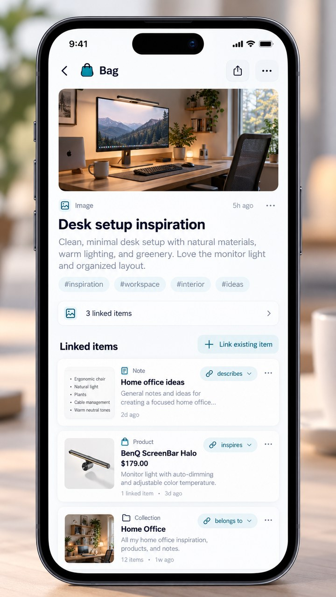

<!-- Stand: Google-Docs-Review v0.2, 31.10.2026. -->

<!-- Produkt- und UX-Konzept, kein Implementierungsnachweis. Technische Ist-Dokumentation: ../architecture.md, ../spec.md und ../../TODO.md. -->

# Bag of Holding

> Produktkonzept · Universelle Sammlung, Suche und Item-Verknüpfungen

Arbeitsdokument zur gemeinsamen Kommentierung · Version 0.2 · 31. Oktober 2026

Status: Konsolidierte Produktlinie (Review v0.2). Leitentscheidungen sind von technischen Prüfaufträgen und weiter offenen Detailfragen zu unterscheiden. Der Code im GitHub-Repository bleibt unverändert.

## 1. Leitidee

Bag ist ein selbstgehosteter persönlicher Ort für alles, was man behalten, wiederfinden oder in Verbindung bringen möchte: Gedanken, formatierte Texte, Bilder, Videos, Links, Produkte und Dateien sowie später externe Termine, Aufgaben und Kontakte. Bag ist weder klassische Ordner-Notiz-App noch vollständiger Ersatz für Kalender, Kontaktverwaltung, Aufgabenmanager oder andere Spezialprogramme. Produktkern: Sammeln → Verstehen und verbinden → Wiederfinden und verwenden.

Leitsatz: Alles sammeln. Nichts organisieren müssen. Alles wiederfinden.

## 2. Bereits entschiedene Prinzipien

- Jedes gespeicherte Original bleibt ein eigenständiges, dauerhaft referenzierbares Item; in der Oberfläche können zusammengehörige Items zu EINEM übersichtlichen Fundstück gebündelt werden.

- Unterschiedliche Inhalte erhalten passende Vorschaukarten und Detailansichten. Ein fachlicher Typ oder eine Ansicht muss nicht jedes Mal einen neuen sichtbaren Feed-Eintrag erzeugen.

- Erfassen ist schnell: keine Pflicht-Tags, Ordner oder Beziehungsauswahl.

- Bestehende Items können miteinander verknüpft werden.

- Manuelle Verknüpfungen sind standardmäßig einfach „Verknüpft mit“. Fachliche Systembeziehungen dürfen präziser sein; frei wählbare manuelle Beziehungstypen kommen frühestens später.

- Beziehungen sind beidseitig sichtbar; das Entfernen einer Verbindung löscht kein Item.

- Suche und Wiederfinden sind Kernfunktionen: Volltext und Filter zuerst; Tippfehlertoleranz, Medienextraktion und semantische Suche folgen schrittweise. Jeder Treffer braucht einen nachvollziehbaren Treffergrund.

## 3. Item-Arten und Darstellungsprinzip

Text — Kurze Idee, Liste oder Snippet; Eigenschaften: Titel und Inhalt.

Formatierter Text — Markdown oder Rich Text; Eigenschaften: Inhalt und Format.

Bild — Vorschau, Metadaten und Bilddetails; mehrere bestehende Bilder können bewusst als Galerie bzw. geordnete Sammlung dargestellt werden, ohne Originale zu duplizieren.

Video — Poster, Laufzeit, Player oder Quelllink; Eigenschaften: Quelle und Laufzeit.

Link — Vorschaubild, Titel und Kurzbeschreibung; Eigenschaften: URL und Website.

Produkt — Bild, Händler, Preis und Kauf-Link; Eigenschaften: Shop, Preis und Währung.

Buch — Cover, Titel, Autor, ISBN und Ausgabe; Angebote und Bezugsquellen bleiben eigenständige, verknüpfte Items.

Datei — Dateisymbol, Vorschau und Download; Eigenschaften: Dateiname, MIME-Typ und Größe.

Technischer Grundsatz: Erfassungstyp (z. B. URL/Datei), erkannter fachlicher Gegenstand (z. B. Buch/Video) und Darstellung (z. B. Galerie) sind zu trennen. Ein Produktlink bleibt technisch ein URL-Original; die erkannte Sache kann referenziert werden, ohne im Feed eine zweite Karte aufzuzwingen. Typisierung und Metadaten bleiben korrigierbar.

## 4. Beziehung zwischen Items – Grundmodell

Eine Relation verbindet zwei eigenständige Items, ohne ihre Originale zu verändern. Für Nutzeraktionen ist „Verknüpft mit“ der Standard; Drag & Drop verknüpft zunächst neutral und reversibel. Systemisch erkannte Fakten dürfen spezifische Beziehungen wie „Angebot für“ nutzen, wenn die Identität ausreichend gesichert ist. Komplexe manuelle Beziehungstypen sind ausdrücklich keine Pflichtfunktion der ersten Ausbaustufen.

### 4.1 Beispiel

Item A: Bild „Schreibtisch-Setup“ ↔ Item B: Text „Ideen zur Kabelführung“. Eine manuelle Verknüpfung bleibt neutral und ist auf beiden Seiten sichtbar. Die gerichtete Relation „beschreibt“ wäre eine optionale spätere Erweiterung, nicht Teil des einfachen Standardablaufs.

### 4.2 Erweiterte Beziehungstypen – zurückgestellt (nicht im Kern-MVP)

Verknüpft mit — symmetrisch: A ist verknüpft mit B.

Beschreibt — gerichtet: A beschreibt B / B wird beschrieben von A.

Gehört zu — gerichtet: A gehört zu B / B enthält A.

Inspiriert — gerichtet: A inspiriert B / B ist inspiriert von A.

Ergänzt — Richtung noch zu entscheiden: A ergänzt B.

**Reviewfrage R1:** Reichen die vier vorgeschlagenen optionalen Beziehungstypen fürs MVP, oder sollten wir mit „Verknüpft mit“ allein starten und Typen danach ergänzen?

## 5. UX: Bestehende Items verknüpfen

1. Detailansicht eines Items öffnen; den Bereich „Verknüpfte Items“ anzeigen.

2. „Item verknüpfen“ öffnet einen Suchdialog auf dem Desktop bzw. eine fast vollflächige Suche auf Mobilgeräten.

3. Die Suche findet vorhandene Items typübergreifend. Treffer zeigen Titel, Typ, kleine Vorschau und ggf. Kontext.

4. Ein oder mehrere Items auswählen; bestehende Verbindungen werden deutlich markiert.

5. „Verknüpfen“ erstellt eine neutrale Relation „Verknüpft mit“; der Nutzer muss keinen Typ wählen. Der Vorgang ist reversibel und zeigt nach Erfolg kurz „Rückgängig“ an.

Erfolg: Der Dialog schließt; die Verbindung erscheint in beiden Detailansichten. Sie lässt sich öffnen, ändern oder entfernen, ohne die Items zu verändern.

**Reviewfrage R2:** Sollen Nutzer beim Speichern für mehrere ausgewählte Items denselben Beziehungstyp wählen können, oder erfolgt die Typwahl bewusst erst danach?

## 6. Darstellungsregeln

- Verknüpfte Items erscheinen als kleine Zeilen oder Karten mit Typ-Icon, Vorschaubild, Titel und Beziehungstext.

- Die Detailansicht bleibt Einstiegspunkt; eine Graphansicht ist keine MVP-Voraussetzung.

- Gerichtete Beziehungen werden nur dort verwendet, wo fachliche Systemdaten sie tatsächlich erfordern; manuelle Beziehungen bleiben zunächst neutral.

- Verbindungen lassen sich öffnen und entfernen. Eine UI zum manuellen Ändern semantischer Beziehungstypen ist kein Bestandteil der ersten Ausbaustufe.

- Eine Relation kann entfernt werden, ohne eines der beiden Items zu löschen.

- Selbstverknüpfungen und unbeabsichtigte doppelte Beziehungen werden verhindert.

**Reviewfrage R3:** Darf dieselbe Item-Paarung mehrere Beziehungen gleichzeitig tragen („beschreibt“ UND „inspiriert“), oder nur eine Beziehung mit wechselbarem Typ? Empfehlung fürs MVP: zunächst eine.

## 7. Suche und verknüpfte Treffer

Die globale Suche ist die zentrale Retrieval-Oberfläche. Zuerst werden Titel, Volltext, eigene Notizen, URLs und strukturierte Metadaten (z. B. Autor, ISBN, Domain, Dateityp, Datum) durchsucht. Treffer zeigen Vorschau, Quelle und den konkreten Treffergrund. Direkte Verknüpfungen können am Treffer sichtbar sein; Inhalte bleiben ohne verpflichtende Tags oder Sammlungen auffindbar.

Ausbauschritte für die Suche: Tippfehlertoleranz und alternative Schreibweisen; bessere deutsche/englische Suche; PDF-Volltext und später OCR für Scans/Bilder; ggf. lokale semantische Ähnlichkeit. Erst später dürfen verknüpfte Items als eigene indirekte Treffer erscheinen – mit klarer Kennzeichnung „Gefunden über …“.

**Reviewfrage R4:** Soll die erste Version verknüpfte Items nur am Suchtreffer anzeigen, oder indirekte Treffer schon als eigene Suchergebnisse anbieten?

## 8. Technische Einordnung im bestehenden Repository

Ausgangsbasis in almighty-atlas/bag (main, geprüft am 31.10.2026): FastAPI, PostgreSQL, Preact/PWA, universelles Item-Modell, vorhandene relation-Tabelle, Capture/Verarbeitung und Volltextsuche. Web- und PWA-Erfassung existieren; browserbasierte Share-Target-Tests auf echten Geräten und die Linux-Shelf-Integration stehen noch aus. Die relation-Tabelle existiert, eine vollständige Relation-UX noch nicht. Die Umsetzung baut auf dem vorhandenen Stack auf, ohne parallelen Speicher oder neue Infrastruktur als Voraussetzung.

- Vorhandene relation-Tabelle verwenden, statt ein paralleles System aufzubauen.

- API: neutrale Relationen in beiden Richtungen lesen, mehrfach auswählen und verknüpfen, Verbindung entfernen; spezielle Systembeziehungen gesondert und herkunftssicher verwalten. Eine manuelle Typ-Editierung folgt später.

- Berechtigungen: Beide Items müssen dem angemeldeten Nutzer gehören und zugänglich sein.

- Richtung und Duplikatregel vor der Implementierung eindeutig festlegen.

- Originaldaten bleiben unverändert; Verknüpfungen betreffen nur Relationen.

- Tests: beidseitige Sichtbarkeit, keine Selbstlinks oder Duplikate, Autorisierung, Entfernen ohne Item-Verlust.

## 9. Umfang des ersten Releases

### Muss enthalten sein

Zuerst den bestehenden Capture-/Shelf-/Suchablauf auf Linux, macOS und Mobilgeräten praktisch absichern. Für die erste Relation-Ausbauscheibe: bestehende Items suchen und neutral verknüpfen, beidseitig anzeigen, öffnen, lösen und rückgängig machen; Basis- und Berechtigungstests. Keine Pflichtauswahl eines Beziehungstyps.

### Bewusst später

Bewusst später: gerichtete manuelle Beziehungen, Graphansicht, frei definierbare Typen, KI-Verknüpfungsvorschläge, komplexe Queries, automatisierte Galerien und Playlists, Produktvergleiche, native Spezial-Apps sowie CalDAV-/CardDAV-Schreibfunktionen.

## 10. Reviewregister – bisherige Fragen und konsolidierte Richtung

**R1 — Standard festgelegt:** Manuelle Beziehungen zunächst ausschließlich „Verknüpft mit“; fachliche Systemrelationen getrennt.

**R2 — Standard festgelegt:** Mehrfachauswahl verknüpft neutral, ohne zusätzliche Typabfrage.

**R3 — Vorläufige technische Regel:** Eine neutrale manuelle Relation pro ungeordnetem Item-Paar; systemische Fachrelationen müssen separat modelliert und dedupliziert werden.

**R4 — Stufenfolge festgelegt:** Direkte Verknüpfungen zunächst als Kontext am Treffer; indirekte Treffer später.

**R5 — Empfehlung:** user_note als kurze eigene Anmerkung und verknüpftes Text-Item als vollwertiges Objekt parallel erhalten; Umwandlung optional später.

**Reviewfrage R5:** Sollen Kurzbeschreibung (user_note) und verknüpftes Text-Item dauerhaft parallel existieren, oder sollte die UI eine Aktion „Aus Notiz ein Item machen“ anbieten?

## 11. So arbeiten wir mit Kommentaren

Bitte bestehende Review-Threads R1–R11 als Diskussionshistorie beibehalten. Die konsolidierte Richtung steht im Produktkern und im Entscheidungsregister; offene technische Detailfragen (insbesondere Datenschutz, Import/Löschung und Identitätsregeln) bleiben kommentierbar. Inhaltliche Änderungen erst nach Bewilligung in die Implementierungsspezifikation übernehmen.

Repository: https://github.com/almighty-atlas/bag

## 12. Automatische Erkennung, Metadaten und eingebettete Inhalte

Status: Neue Konzeptidee (31.10.2026) – noch nicht implementiert; Details werden gemeinsam im Review entschieden.

### 12.1 Zielbild

Wenn ein Nutzer eine URL, Datei oder ein Medium in Bag ablegt, wird der Originalinhalt sofort dauerhaft gespeichert. Anschließend versucht Bag automatisch zu verstehen, WAS darin steckt – etwa ein Buch, ein Video, ein Produkt, ein Artikel oder ein Rezept. Titel, Vorschaubilder, Autoren, IDs und weitere strukturierte Angaben werden nach Möglichkeit ergänzt. Keine zusätzliche Pflichtarbeit beim Erfassen.

Entscheidend ist die Trennung zwischen Quelle, erkanntem Gegenstand und Beziehung: Ein Shop-Angebot ist nicht identisch mit dem Buch, auf das es verweist.

### 12.2 Beispiel: Amazon-Link zu einem Buch

1. Ein Amazon-Produktlink wird wie bisher als unverändertes URL-Item gespeichert; die Erfassung wird sofort bestätigt.

2. Ein Hintergrundjob liest zulässige Seitendaten und ermittelt die fachliche Kategorie „Buch“, soweit möglich anhand von strukturierten Metadaten (z. B. schema.org/Book oder Product), Seitentitel, Autor, ASIN oder ISBN.

3. Wenn eine verlässliche ISBN vorliegt, werden zusätzliche bibliografische Daten aus geeigneten Quellen abgefragt, etwa Open Library; Google Books ist eine mögliche ergänzende Quelle.

4. Bag prüft zunächst, ob es den erkannten Buchgegenstand bereits kennt. Bei ausreichend verlässlicher Identität wird er intern als fachliches Objekt/Item referenziert oder wiederverwendet; eine zweite sichtbare Feed-Karte entsteht dadurch nicht automatisch. Eine unsichere Zuordnung bleibt Vorschlag.

5. Das ursprüngliche URL-Item bleibt als Quelle erhalten und erhält, falls identifiziert, eine systemische Beziehung zum Buch („Angebot für“/„Verweist auf“). Mehrere Angebote können auf denselben Gegenstand zeigen, ohne die einzelnen Original-URLs zu verschmelzen.

6. Das Buch erscheint in Bag mit Cover, Titel, Autor, ISBN, Sprache, Verlag und ggf. Ausgabe/Erscheinungsdatum – nur soweit diese Informationen tatsächlich verfügbar sind. Preis und Verfügbarkeit bleiben Eigenschaften eines Händler-Angebots und werden nicht fälschlich als allgemeine Buchmerkmale behandelt.

Beispiel einer Beziehung: „Amazon-Angebot“ → [Angebot für] → „Der Name des Windes“ (Buch). Ein zweiter Anbieter-Link kann dasselbe Buch-Item referenzieren. Eine persönliche Textnotiz kann das Buch zusätzlich über „Verknüpft mit“ kommentieren.

Wichtig: Eine ASIN ist keine allgemein zuverlässige ISBN. Ohne belastbare Zuordnung soll Bag nur einen Vorschlag anzeigen, statt zwei unterschiedliche Bücher oder Ausgaben fälschlich zusammenzuführen.

### 12.3 Gemeinsames Inhaltsmodell

Gespeichertes Item: Das Original – URL, Text, Bild oder Datei – inklusive eigener Notizen und Erfassungszeitpunkt.

Erkanntes Objekt: Fachlich typisierter Gegenstand wie Buch, Video oder Produkt mit Identifikatoren und Metadaten. Intern kann er ein zusätzliches Item sein oder auf einer wiederverwendbaren Objektidentität beruhen; die Darstellung bündelt ihn mit seinen Quellen zu einem Fundstück. Eine belastbare Identitätsregel und Datenmigration sind vor Umsetzung festzulegen.

Relation: Verknüpft Quelle und erkanntes Objekt oder mehrere vorhandene Objekte. Automatisch angelegte Relationen tragen einen erkennbaren Ursprung „System“; manuelle Relationen behalten Vorrang.

Metadatenfeld: Wert, Quelle/Provider, Ermittlungszeitpunkt und ggf. Konfidenz. Nutzerkorrekturen dürfen durch spätere Enrichment-Läufe nicht überschrieben werden.

Duplikatschutz: Bücher über passende Editions-ID/ISBN, Videos über Plattform + Video-ID, sonst nur mit ausreichend sicheren Identifikatoren. Unsichere Treffer bleiben Kandidaten.

### 12.4 Videos und Einbettung

Ein YouTube- oder anderer unterstützter Videolink bleibt als Original-URL erhalten. Bag erkennt nach Möglichkeit Plattform-ID, Titel, Kanal, Thumbnail und Dauer und zeigt eine angereicherte Videokarte. Falls ein separates Video-Item sinnvoll ist, wird es intern verknüpft und nicht ungefragt als Duplikat im Feed gezeigt.

Die Detailansicht soll – wenn der jeweilige Anbieter Einbettung erlaubt – einen echten Player anbieten, nicht bloß einen Link. Der Player wird erst nach bewusster Nutzeraktion geladen (externe Verbindung, Cookies/Tracking und Datenschutz beachten). Sonst erscheint eine große Vorschau mit „Beim Anbieter öffnen“.

Keine pauschale Ausführung fremden Embed-Codes: Anbieter-spezifische, geprüfte Player-URLs, restriktives iframe/Sandbox- und CSP-Konzept. Downloads, Transkription und Zusammenfassungen sind eigenständige, optionale spätere Ausbaustufen.

### 12.5 Sichtbare UX statt unkontrollierter Automatik

Beim Speichern: „Gespeichert“ sofort; danach nicht-blockierend „Metadaten werden ergänzt“ und schließlich eine passende Kartenansicht.

Eintrag im Feed: Pro gespeichertes Fundstück standardmäßig eine passende Buch-/Video-/Produktkarte. Zusätzliche technische Quellen oder erkannte Gegenstände werden in der Detailansicht aufklappbar gezeigt, nicht als unkontrollierter Strom neuer Karten. Mehrere unabhängige Nutzer-Captures bleiben separat nachvollziehbar; Gruppierung darf ihre Erfassungsgeschichte nicht verlieren.

In der Detailansicht: „Automatisch erkannt als …“ mit Quelle, Erkennungsstatus und bei Bedarf „Korrigieren“, „Zuordnung bestätigen“ und „Verknüpfung lösen“. Automatische Aktionen müssen sichtbar und rückgängig machbar sein; Nutzerkorrekturen haben Vorrang.

Falls kein eindeutiger Treffer gefunden wird: die ursprüngliche Linkkarte beibehalten. Keine stillschweigende falsche Klassifizierung oder erzwungene Zusammenführung.

### 12.6 Verarbeitung – vorgeschlagene Stufen

Capture → Original sofort sichern → Quelle sicher abrufen → Metadaten auswerten → Identifikatoren validieren → ggf. erlaubte Provider nach Opt-in abfragen → Gegenstand wiedererkennen oder vorschlagen → sichere Systemrelation anlegen → Suchindex und gebündelte Karte aktualisieren. Jeder Schritt läuft asynchron und darf keine Pflichtinteraktion beim Erfassen erzeugen.

Robustheit: Jobs laufen asynchron mit klaren Zuständen; Ausfälle externer Anbieter dürfen das Speichern niemals verhindern. Externe HTTP-Zugriffe behalten vorhandenen SSRF-Schutz, Redirect-/IP-Prüfung, Größen- und Zeitlimits.

Datenschutz und Recht: Externe Metadatenabfragen müssen konfigurierbar sein. Nutzungsbedingungen, API-Berechtigungen, Ratelimits und Rechte an Bildern sind zu beachten. Amazon-Katalogdaten sind nicht beliebig über eine frei verfügbare API nutzbar; die aktuelle Creators API richtet sich an berechtigte Partner. Direkte Shop-Erkennung sollte zunächst auf tatsächlich verfügbare Seitendaten und offene Buchquellen setzen.

### 12.7 Empfohlene Reihenfolge

Ausbau B (nach stabilem Capture): Reichhaltige Link-Vorschau und geeignete Videoeinbettung; Original-URL immer erhalten, Quelle und Erkennungsstatus sichtbar. Nicht Voraussetzung für den ersten geräteübergreifenden Ablauf.

Ausbau B/C: Buch-Erkennung über valide Identifikatoren, Metadatenanreicherung und automatisch nachvollziehbare Systemrelationen. Bei unsicherer Identität nur Vorschlag; nicht automatisch eine weitere Feed-Karte erstellen.

Später: mehrere Händlerangebote pro Produkt, zusätzliche Video-Anbieter, tieferes Medienverständnis, Transkripte, lokale KI und automatische Relationsempfehlungen.

### 12.8 Reviewarchiv – R6/R7 mit festgelegter Richtung, R8 bleibt offen

**Reviewfrage R6:** Soll Bag beim Ablegen eines erkannten Buchlinks automatisch ein separates Buch-Item erstellen oder zunächst nur eine angereicherte Buchkarte zeigen und erst bei Bedarf ein eigenständiges Buch-Item anlegen?

**Reviewfrage R7:** Sollen automatisch erzeugte Buch-/Video-Items im normalen Feed auftauchen oder standardmäßig nur als Darstellung/Verknüpfung des ursprünglichen Eintrags sichtbar sein?

**Reviewfrage R8:** Dürfen externe Metadatenanbieter sofort nach dem Speichern kontaktiert werden (Opt-in je Instanz), oder soll Bag grundsätzlich ausschließlich lokale bzw. bereits gespeicherte Metadaten verwenden, bis der Nutzer die Anreicherung aktiviert?

### 12.9 Quellen und technische Referenzen (Planungsgrundlage)

Open Library Books / Works / Editions / ISBN: https://openlibrary.org/dev/docs/api/books

Open Library API-Nutzungsrichtlinien: https://openlibrary.org/developers/api

Google Books Volumes API: https://developers.google.com/books/docs/v1/using

Schema.org Book: https://schema.org/Book

Schema.org Product: https://schema.org/Product

Schema.org VideoObject: https://schema.org/VideoObject

YouTube eingebetteter Player: https://developers.google.com/youtube/player_parameters

Amazon Creators API (Zugangsbedingungen prüfen): https://affiliate-program.amazon.com/creatorsapi/docs/en-us/introduction

## 13. Design-Mockups – Desktop und Smartphone

Diese sechs Visualisierungen sind gestalterische Referenzen, keine bereits implementierten Screens. Sie zeigen teilweise eine ältere Navigationsstruktur mit prominenten Tags/Collections sowie Beziehungstyp-Auswahl. Für die konsolidierte Version gelten die schlanke Navigation, neutrale manuelle Relationen und gebündelte Fundstücke als maßgebliche UX-Vorgaben; die Mockups sind entsprechend erst bei der späteren UI-Ausarbeitung zu überarbeiten.

### 13.1 Desktop – Universeller Feed und Schnellerfassung

Abbildung 1 · Gemischter Feed mit Text-, Bild-, Produkt-, Link-, Datei- und Videokarten sowie zentraler Suche.

### 13.2 Desktop – Item-Detail und Beziehungen

Abbildung 2 · Großes Bild mit persönlicher Notiz und verknüpften Items. Gezeigte manuelle Beziehungstyp-Chips sind eine spätere Option, keine MVP-Pflicht.

### 13.3 Desktop – Leistungsfähige Suche

Abbildung 3 · Typübergreifende Suche mit Filtern und nachvollziehbaren Treffergründen. Indirekte Treffer sind eine spätere Erweiterung.

### 13.4 Smartphone – Mobiler Feed

Abbildung 4 · Touch-freundliche Startseite mit schneller Erfassung und unterschiedlichen Karten.

### 13.5 Smartphone – Item-Detail und Beziehungen

Abbildung 5 · Bildansicht mit direkt erreichbaren, typisierten verknüpften Items.

### 13.6 Smartphone – Bestehende Items verknüpfen

Abbildung 6 · Mehrfachauswahl und neutrale Verknüpfung; im finalen Kern-MVP entfällt die manuelle Typwahl.

## 14. Historischer Zwischenstand – verbindliche Roadmap in Abschnitt 17

Nächste Schritte: die konsolidierte Produktlinie (Sammeln → Verstehen/Verbinden → Wiederfinden) anhand realer Alltagsszenarien prüfen, die bestehenden End-to-End-Flows verlässlich machen und danach den Implementierungsplan in almighty-atlas/bag aktualisieren. Die noch offenen technischen Detailfragen sind im Reviewregister dokumentiert; der Code bleibt bis zu einer separaten Umsetzungsentscheidung unverändert.

## 15. Externe CalDAV-/CardDAV-Datenquellen – Konzeptentwurf

Status: Grundsatz beschlossen – Bag integriert bestehende DAV-Server und ist in diesem Ausbauschritt kein eigener CalDAV-/CardDAV-Server. R9 (Feed-Sichtbarkeit) und R10 (zunächst read-only) sind in der konsolidierten Produktlinie festgelegt; die Aufbewahrung entfernter Quelldaten (R11) bleibt offen.

### 15.1 Produktrolle und klare Grenze

Bag ist universelle Ablage, Suche und Beziehungsschicht. Ein angebundener DAV-Server bleibt die maßgebliche Quelle für Termin-, Aufgaben- und Kontaktdaten. Bag führt keine zweite konkurrierende Kalender-/Kontakt-Datenbank als Master. Lokale Spiegel-/Indexdaten dienen Vorschau, Suche, Verknüpfung und Nachvollziehbarkeit.

Für den ersten Ausbauschritt werden entfernte Daten gelesen, aber nicht verändert. Spätere Schreiboperationen (Aufgabe abhaken, Termin verschieben, Kontakt korrigieren) brauchen eine ausdrücklich aktivierte, geprüfte bidirektionale Synchronisierung.

### 15.2 Fachliche Item-Typen

Kalendertermin = CalDAV / VEVENT: Titel, Ort, Start, Ende, Zeitzone, Beschreibung, ggf. Teilnehmer und Wiederholungsregeln. Ganztägige Termine und Zeitzonen müssen korrekt dargestellt werden.

Aufgabe = CalDAV / VTODO: Titel, Beschreibung, Status, Start/Fälligkeit, Priorität und ggf. Wiederholung. Nicht jeder Kalender bzw. Client bietet VTODO an; die verfügbaren Collections werden einzeln geprüft.

Kontakt = CardDAV / vCard: Anzeigename, Telefonnummern, E-Mail-Adressen, Anschriften, Organisation, Website und bei Bedarf Foto. Unbekannte vCard-Felder sollen beim Lesen nicht verloren gehen.

Die drei Typen sind echte, suchbare Bag-Items mit spezifischen Vorschauen. Eine Kontaktkarte ist keine bloße Textnotiz; eine Aufgabe ist nicht bloß eine manuell gesetzte Checkbox.

### 15.3 UX – Quelle verbinden

1. Einstellungen → Datenquellen → CalDAV / CardDAV hinzufügen.

2. DAV-Endpunkt und Benutzerkonto angeben; automatische Server-/Principal-/Collection-Erkennung bevorzugen.

3. Die gefundenen Kalender, Aufgabenlisten und Adressbücher einzeln auswählen. Für jede Collection Importumfang und Sichtbarkeit konfigurieren.

4. Vor dem ersten Import zeigt Bag eine Vorschau: geschätzte Anzahl, Datenarten, Suchindexierung, Datenschutz und Speicherbedarf.

5. Nach Bestätigung erfolgt der erste Import im Hintergrund mit sichtbarem Fortschritt, letztem Sync und Fehlermeldungen. Quellen können pausiert, getrennt und neu synchronisiert werden.

Nextcloud eignet sich als erste Testimplementierung, die Integration muss aber standardkonform und nicht Nextcloud-exklusiv sein. Die Basis befindet sich bei üblichen Nextcloud-Installationen unter /remote.php/dav; Discovery über /.well-known/caldav und /.well-known/carddav sollte berücksichtigt werden. Bei Pocket-ID-/OIDC- oder 2FA-Setups kann für DAV ein dediziertes App-Passwort notwendig sein.

### 15.4 UX – in Bag wiederfinden und verknüpfen

Beim globalen Suchen sind Termine, Aufgaben und Kontakte als eigene Typen filterbar; Treffer zeigen ihre Herkunft und den Zeitpunkt der letzten erfolgreichen Synchronisierung.

Im normalen Sammel-Feed werden importierte externe Termine, Aufgaben und Kontakte standardmäßig nicht eingeblendet; sie erscheinen in Suche und Verknüpfungsdialog. Einzelne Objekte lassen sich auf Wunsch anheften. Das vermeidet eine Flut von DAV-Importen im Capture-Feed.

Item-Detail: fachlich passende kompakte Karte, Link „In Kalender/Tasks/Kontakten öffnen“ (falls ein sicherer Deep Link verfügbar ist), dazu normale Bag-Sektion „Verknüpfte Items“.

Manuelles Drag & Drop verbindet bestehende Items, ohne den DAV-Server zu verändern. Beispiel: Bild auf Kontakt ziehen → einfach verknüpfen; PDF auf Termin → verknüpfen; Bild auf Bild → einfach verknüpfen. Die gesonderte Aktion „Galerie erstellen“ bleibt optional und darf nicht beim bloßen Ablegen stillschweigend passieren.

Erste Version: Standardsuche, Typfilter, vorhandene Items suchen und Beziehungen zwischen allen lokalen und externen Item-Typen anlegen. Später: Vorschläge wie „Ticket ↔ Termin“ oder „Kontakt ↔ Meeting“ als überprüfbare Empfehlungen.

### 15.5 Datenmodell und Identität

Bag-Item bleibt ein stabiler lokaler Verweis auf ein externes Objekt, nicht dessen neuer Masterdatensatz. Empfohlene zusätzliche Daten: connector_id, source_kind (caldav/carddav), collection_id/URL, resource_href, remote_uid, remote_etag, last_synced_at, remote_status und read_only sowie ein normalisierter Such-/Darstellungs-Snapshot.

Die technische Identität ist je Quelle/Collection/Resource zu führen; eine UID allein darf nicht für ein globales Zusammenführen ausreichen. Verschiedene Adressbücher können dieselbe Person getrennt enthalten. Kontakte werden daher nicht automatisch anhand von Namen oder E-Mails zusammengeführt.

Wiederholende Kalenderereignisse benötigen eine nachvollziehbare Trennung zwischen Terminserie und Einzelvorkommen: zunächst ein Item je Serienobjekt mit korrekter Darstellung der Termine einschließlich Ausnahmen. Beziehungen zu einer ganz bestimmten Instanz werden erst dann unterstützt, wenn ihre Identität und Synchronisierung zuverlässig modelliert sind.

Beziehungen, user_note und lokale Tags gehören Bag. Externe Feldänderungen dürfen sie niemals überschreiben. Umgekehrt schreiben lokale Bag-Metadaten nicht in DAV zurück.

### 15.6 Synchronisierung und Fehlerfälle

Erster Import: ausgewählte Collections lesen, Objekte validieren, stabile lokale Item-Identitäten anlegen, Vorschauen und Suchindex erzeugen.

Folgesync: Sync-Token / WebDAV sync-collection (RFC 6578) bevorzugen; sonst ETag-basierte Vergleiche mit geeigneten CalDAV-/CardDAV-REPORTs bzw. PROPFIND. Bei abgelaufenen Tokens einen sicheren Vollabgleich durchführen.

Quellenänderung: externe Item-Felder und Suchindex aktualisieren, während Bag-spezifische Relationen erhalten bleiben. Serverfehler, Timeouts und ungültige Objekte müssen einzeln nachvollziehbar sein.

Entfernung beim DAV-Server: Das Bag-Item nicht stillschweigend samt Verknüpfungen vernichten. Stattdessen als „Quelle entfernt“ markieren; Nutzer kann Bezug lösen oder die bisherige Referenz bewusst archivieren. Ein schaltbarer Snapshot-Retention-Modus entscheidet, ob sensible fremde Inhalte dauerhaft lokal erhalten bleiben.

Abkoppeln einer Datenquelle: Vorher die Folgen zeigen (Suchbarkeit, Snapshots, Relationen). Keine Löschung von externen Kalendern, Aufgabenlisten oder Adressbüchern durch „Trennen“.

Für späteres Schreiben: Änderungen ausschließlich mit expliziter Aktion und Rechtesteuerung, bedingten Schreiboperationen per ETag/If-Match, sichtbarer Konfliktbehandlung, Rückmeldung bei Fehlschlag und sicherer Synchronisationsqueue. Keine stillen „last write wins“-Überschreibungen.

### 15.7 Datenschutz und Sicherheit

Kontakte und Termine enthalten häufig personenbezogene bzw. sensible Daten. Deshalb Opt-in für jede Collection; kein automatischer Vollimport aller Adressbücher oder Kalender.

Zugriffsdaten nur verschlüsselt im geeigneten Secret Store, niemals im Logging oder als Klartext im Item. TLS prüfen, Zertifikatsfehler nicht stillschweigend ignorieren, fremde DAV-Endpunkte und Redirects gegen SSRF und unerwartete Netzziele absichern.

Suche ist zunächst lokal/lexikalisch. Embeddings, lokale KI und externe Indexdienste sind für DAV-Daten separat konfigurierbar und standardmäßig nicht an externe Drittanbieter zu übermitteln.

Termininhalte, private Kontakte und Gäste/Teilnehmer dürfen durch geteilte Bag-Items nicht versehentlich sichtbar werden. ACLs und Eigentümerschaft gelten auch für Suchtreffer, Vorschaubilder und Relationen.

### 15.8 Phasenplanung

Phase DAV-1 (read-only): Eine Nextcloud-CalDAV-Quelle verbinden, Kalender auswählen, VEVENT abrufen, Items anzeigen und durchsuchen, lokale Beziehungen erstellen, Sync und Entfernen testen.

Phase DAV-2: VTODO und CardDAV/vCard ergänzen, per Collection auswählbare Sichtbarkeit, Kontakte in der Item-Suche, verlässliche Datenherkunft und Statusmeldungen.

Phase DAV-3 (optional): Bidirektionale Einzelaktionen und Änderungen, aber erst nach Tests für Schreibrechte, Konflikte, Wiederholungen, Offline-Fälle und echte Client-Interoperabilität.

### 15.9 Reviewarchiv – R9/R10 festgelegt, R11 bleibt offen

**Reviewfrage R9:** Sollen importierte Termine, Aufgaben und Kontakte standardmäßig aus dem normalen Feed ausgeblendet sein, aber immer in Suche und Verknüpfungsdialogen zur Verfügung stehen? Empfehlung: Ja.

**Reviewfrage R10:** Ist der erste DAV-Release bewusst read-only und dürfen Aufgaben/Termine/Kontakte erst in einer späteren Phase aus Bag heraus geändert werden? Empfehlung: Ja.

**Reviewfrage R11:** Wenn ein Objekt auf dem DAV-Server entfernt wird, soll Bag nur die Relation mit Status „Quelle entfernt“ bewahren oder optional auch eine lokale Momentaufnahme der Inhalte behalten dürfen? Datenschutz und spätere Wiederherstellung sind abzuwägen.

### 15.10 Protokoll- und Anbieterreferenzen

CalDAV – RFC 4791: https://www.rfc-editor.org/rfc/rfc4791

CardDAV – RFC 6352: https://www.rfc-editor.org/rfc/rfc6352

WebDAV Sync – RFC 6578: https://www.rfc-editor.org/rfc/rfc6578

Nextcloud DAV-Endpunkte und Discovery: https://docs.nextcloud.com/server/stable/admin_manual/issues/general_troubleshooting.html

Nextcloud WebDAV und App-Passwörter: https://docs.nextcloud.com/server/stable/developer_manual/client_apis/WebDAV/basic.html

## 16. Konsolidiertes Produktkonzept – maßgebliche UX-Leitlinien (v0.2)

Status: Die hier beschriebenen Produkt- und Priorisierungsentscheidungen sind nach gemeinsamer Diskussion akzeptiert. Ältere Screenshots und offene Review-Kommentare dokumentieren die Entstehung; widersprüchliche Vorschläge in früheren Abschnitten sind durch die nachfolgenden Leitlinien ersetzt. Technische Detailfragen sind entsprechend gekennzeichnet.

### 16.1 Die drei Kernaktionen

**SAMMELN** — Jeder Inhalt lässt sich ohne Pflichtmetadaten und ohne Zielauswahl schnell erfassen. Der Capture-Vorgang gilt erst als erfolgreich, wenn das Original auf dem Bag-Server dauerhaft gesichert ist. Erfassung über Web, PWA, systemisches Teilen und Linux-Shelf verwendet dieselbe API.

**VERSTEHEN UND VERBINDEN** — Im Hintergrund werden zulässige Metadaten ergänzt und vorhandene Gegenstände erkannt. Beziehungen lassen sich direkt anlegen, ohne komplizierte Typauswahl. Automatische Ergebnisse zeigen Herkunft, Qualität und Korrekturmöglichkeiten.

**WIEDERFINDEN UND VERWENDEN** — Globale Suche ist die zentrale Oberfläche. Jedes Item bietet passende Aktionen zum Öffnen, Kopieren, Teilen oder Herunterladen; externe Daten können in ihrer Ursprungsanwendung weiterbearbeitet werden.

Produktgrenze: Bag ist keine vollständige Kalender-, Aufgaben-, Kontakte-, Medien- oder Shopping-Anwendung. Es führt verteilte Informationen zum persönlichen Wiederfinden zusammen, ohne bestehende Spezialprogramme nachzubauen.

### 16.2 Ein klarer Unterschied: Original, Gegenstand und Darstellung

Erfasstes Original (Capture): Ein konkretes URL-, Text-, Bild- oder Datei-Item mit unverändertem Inhalt, Erfassungszeitpunkt und Herkunft. Ein zweiter eigenständiger Capture kann eine eigene Notiz oder einen anderen Kontext haben und darf nicht stillschweigend verschwinden.

Erkanntes Objekt (Entity): Ein fachlich wiedererkannter Gegenstand wie Buch, Video oder Produkt mit stabilen Identifikatoren und Metadaten. Er darf intern als referenzierbares Item oder als eigenständiges Objektmodell existieren. Die Wahl ist vor der Datenmigration als Architekturentscheidung (ADR) festzulegen.

Darstellung / Fundstück (View): Der Feed zeigt zusammengehörige Informationen in EINER primären Karte, soweit die Zuordnung verlässlich und für den Nutzer nachvollziehbar ist. Zugehörige Quell-URLs, Angebote, Extrakte und verknüpfte Gegenstände werden in der Detailansicht sichtbar. Die visuelle Bündelung darf niemals Datensätze löschen, widersprüchliche Quellen verdecken oder zwei unterschiedliche Ausgaben eines Buchs ungefragt zusammenführen.

Beispiel: Mehrere Händler-Links verweisen auf dasselbe verifizierte Buch. Im Feed steht eine Buchkarte mit Herkunftshinweis; darunter lassen sich einzelne Angebote, Preise und selbst geschriebene Notizen aufklappen. Preis und Verfügbarkeit gehören zu Angeboten, nicht zur zeitlosen Buchbeschreibung.

Technische Akzeptanzregel: Eine gesicherte Item-ID und zugehörige manuelle Relation muss beim Umbauen der Präsentation, beim Neuindexieren und nach Backups weiterhin dieselbe Identität behalten.

### 16.3 Eine ruhige, reduzierte Navigation

Primäre Navigation Desktop: Zuletzt gespeichert (gleichzeitig der vollständige Shelf-Einstieg), Suchen und Merkliste. Sammlungen können als sekundärer Bereich angeboten werden. Datenquellen und Einstellungen liegen getrennt in Verwaltung/Mehr.

Auf Mobilgeräten stehen Erfassung/Teilen, die zuletzt gespeicherten Items, Suche und Merkliste im Vordergrund. Keine direkte Übertragung der Desktop-Seitenleiste oder ein eigener zweiter Shelf-Datenspeicher.

Tags sind optionale Metadaten und Suchfilter, keine ständig sichtbare Hauptnavigation und nie Pflicht. Collections bleiben optional und ermöglichen beispielsweise eine Galerie bzw. eine kuratierte Gruppe, ohne Items exklusiv einzusortieren.

Alte Mockups: Linksseitige Bereiche wie Tags, Linked Items und Collections sind Designexploration, nicht zwingende Navigationspunkte. Für zukünftige Mockups gelten diese schlankere Navigation sowie gebündelte Fundstücke und neutrale manuelle Verknüpfungen.

### 16.4 Merkliste und schnelle Wiederaufnahme

Ein Item oder Fundstück kann mit einem einfachen Stern/Pin in die Merkliste aufgenommen werden. Merken ist keine Aufgabe, kein neues Item und keine Pflichtzuordnung zu einer Sammlung. Der ursprüngliche Feed, die Suche und die Originaldaten bleiben unverändert.

Die Merkliste ist geräteübergreifend verfügbar und kann angeheftete Items bei Bedarf nach letzter Verwendung oder Merken-Zeitpunkt sortieren. Auf Mobilgeräten reichen Öffnen, Kopieren, Teilen und Merken als wichtigste Kontextaktionen.

Eine bewusst kleine Weiterentwicklung wäre „Zuletzt verwendet“ bzw. „Weitermachen“, ohne eigenständiges Aufgaben- oder Reminder-System. Erinnerungsfunktionen sind zunächst ausgeschlossen.

### 16.5 Suche als Qualitätskern

Reihenfolge: Zuerst vollständige und korrekte Volltextsuche, strukturierte Metadaten und Filter. Danach Tippfehlertoleranz, Wortvarianten, Mehrsprachigkeit und verbesserte Trefferbegründung. Danach PDF-OCR/Bilderkennung; semantische Suche nur als optionale Erweiterung ohne Pflicht-Cloud und ohne intransparente Treffer.

Suchtreffer enthalten Titel, Item-Typ, passende Vorschau, relevante Auszüge, Quelle/Herkunft und sichtbaren Treffergrund, z. B. „Im PDF-Text“, „Autor“ oder „Über verknüpftes Item“. Direkte Treffer müssen von indirekt gefundenen Items klar unterscheidbar sein.

Filtern nach fachlichem Typ, Quelltyp, Domain, Datum, bekannten Identifikatoren (z. B. ISBN), externen Datenquellen und selbst vergebenen optionalen Tags. Das Suchfeld bleibt Hauptzugang; Nutzer müssen sich keine Ordner- oder Tagsystematik merken.

Fehlerfälle: Ein nicht extrahierbares PDF, eine kaputte URL oder fehlende Metadaten bleiben als originale, auffindbare Items bestehen und bekommen einen verständlichen Verarbeitungsstatus mit Wiederholen-Aktion.

### 16.6 Beziehungen, Drag & Drop und Galerien

Standardaktion: Bild auf Bild ziehen → einfach verknüpfen. Ebenso Text auf Bild oder Kontakt auf Termin → zunächst eine neutrale, reversible Relation. Ein sichtbares „Rückgängig“ folgt auf jede erfolgreiche manuelle Verknüpfung.

Ein langes Ziehen oder Ablegen darf nicht ungefragt eine Galerie, eine Playlist oder einen Produktvergleich erstellen. „Galerie erstellen“ ist eine separate, bewusste Aktion aus zwei oder mehreren ausgewählten Bild-Items. Technisch sollte sie eine geordnete Sammlung/Ansicht referenzierter Originale nutzen, statt Bilddateien zu kopieren. Ob eine Galerie im Datenmodell als spezialisiertes Item oder Sammlung realisiert wird, entscheidet eine enge Implementierungs-ADR.

Mobiler und barrierefreier gleichwertiger Weg: Items per Mehrfachauswahl und „Verknüpfen“ verbinden; kein Feature darf ausschließlich durch Drag & Drop erreichbar sein. Tastaturbedienung, Screenreader, Feedback bei ungültigem Drop sowie Rückgängig müssen geprüft werden.

Verschachtelte Galerien, Graph-Ansichten, frei definierbare Relationstypen, Playlists, Vergleiche und automatische Merge-Aktionen sind keine Voraussetzungen für die nächste Produktstufe.

### 16.7 Transparente, korrigierbare Automatik

Metadatenanreicherung startet nach erfolgreicher Speicherung im Hintergrund. Das Original bleibt unverändert. Nutzereingaben haben Vorrang vor automatischer Erkennung und erneuter Verarbeitung.

Zu jeder fachlichen Zuordnung speichert Bag soweit verfügbar den Provider, verwendete Identifikatoren, Erkennungszeitpunkt und Unsicherheit. Die Detailansicht bietet „Quelle anzeigen“, „Zuordnung korrigieren“, „Verknüpfung lösen“ und ggf. „Rückgängig“.

Bei zwei unsicheren Kandidaten darf Bag keine automatische Zusammenführung vornehmen. Die Oberfläche bietet einen überprüfbaren Vorschlag, ohne den Feed mit zusätzlichen Kandidatenkarten zu überschwemmen.

Externe Metadatenabfragen sind pro Instanz/Provider konfigurierbar und dürfen nicht unbemerkt private Inhalte an Dritte übertragen. Bei nicht erreichbaren Datenquellen oder ungültigem Zugang bleiben Original und lokale Annotationen nutzbar.

### 16.8 Einheitliche Vorschauen und Aktionen

Jede Karte soll nachvollziehbar zwischen „Original öffnen“, „In Bag ansehen“ und „Bei Quelle öffnen“ unterscheiden. Je nach Typ sind Kopieren, Teilen, Herunterladen, Merken, Verknüpfen und Entfernen verfügbar – aber nicht jedes Item zeigt alle Aktionen zugleich.

PDFs und Bilder brauchen sinnvolle Vorschauen und den Zugang zur unveränderten Datei. Links und Bücher behalten ihre Quellen, Videos erhalten einen Player nur für unterstützte und zulässige Einbettungen; ein fehlender Player ist kein Verlust des URL-Items.

Die gleichen grundlegenden Aktionen werden für Linux-Shelf, macOS-Web/PWA und mobile Browser/Share-Target angeboten, jeweils in der nativen Interaktionsform der Plattform.

### 16.9 Löschen, Trennen, Export und Wiederherstellung

Eine Galerie/Ansicht entfernen darf ihre enthaltenen Originalbilder nicht löschen. Eine manuelle Relation entfernen löscht weder Quelle noch Ziel. Ein erkanntes Objekt von einer Quelle trennen bewahrt den ursprünglichen Capture.

Eine DAV-Datenquelle trennen verändert niemals Kalender, Aufgaben oder Kontakte am DAV-Server. Ist ein externer Datensatz gelöscht, bewahrt Bag nur so viel Verweis-/Snapshot-Information, wie Datenschutz und eine ausdrücklich gewählte Aufbewahrungsregel erlauben.

Export und späterer Import müssen gespeicherte Originale, Notizen, Quellenmetadaten, manuelle und systemische Relationen, Galerien/Sammlungen, Merkliste und eine wiederherstellbare Zuordnung zwischen ihren IDs berücksichtigen. Sensible Zugangsdaten und aktive DAV-Sessions gehören ausdrücklich NICHT in den normalen Inhalts-Export.

Backups benötigen einen dokumentierten Restore-Test; Identitäten und Relationen müssen nach Wiederherstellung intakt bleiben. Löschvorgänge sind klar zwischen „Verknüpfung entfernen“, „In Papierkorb“ und „Endgültig löschen“ getrennt.

### 16.10 Verbindliche Streichliste für frühe Releases

Nicht bauen: eigener CalDAV-/CardDAV-Server, vollwertige Aufgaben- oder Kalenderbearbeitung, lokale native Mobil-Apps als Voraussetzung, eigene P2P-Übertragung, automatischer Clipboard-Abgleich, KI-Chat als Hauptfunktion, universeller Medienplayer, komplizierte Graphansicht, intelligente Regeln für jede mögliche Item-Paarung.

Nicht in der Hauptnavigation priorisieren: separate Linked-Items-Übersicht, Tags als zentrale Rubrik, mehrere konkurrierende Inbox-/Shelf-/Feed-Speicher. Kein separates Transfer- oder Zwischenspeicherprodukt neben Bag.

Nicht voraussetzen: KI, Cloud-Embeddings, externer Metadatenanbieter, neue Datenbankdienste oder sofort schreibende externe Connectoren. Das System muss auch mit diesen Funktionen ausgeschaltet sinnvoll nutzbar bleiben.

## 17. Umsetzungsreihenfolge, Alltagsszenarien und Erfolgskriterien

### 17.1 Produktstufe A – zuverlässige Alltagsablage

Vorhandene Erfassung, Worker, Suche, Vorschauen und Web/PWA fertigstellen statt sofort neue Datenmodelle einzuführen. Android Share Target und macOS Browser end-to-end testen, Linux-Shelf über DMS/Niri als kleinsten tragfähigen Ablauf erproben. Eine einzige kürzliche-Items-Ansicht, gutes Kopieren/Öffnen/Teilen, klare Fehlerzustände und Merkliste priorisieren.

Akzeptanz: Auf einem Gerät speichern, serverseitige Bestätigung erhalten, nach Aktualisierung auf einem anderen Gerät finden, originalgetreu öffnen/herunterladen. Fehlgeschlagene oder offline nicht bestätigte Captures dürfen niemals fälschlich als erfolgreich angezeigt werden.

### 17.2 Produktstufe B – Inhalte verstehen

Strukturierte URL-Vorschau, Buch-/Video-Erkennung, prüfbare Identifikatoren, sichere Videoeinbettung und einfache Metadatenquellen; die Darstellung pro Fundstück bündeln. Danach verbesserte Suchfilter und Tippfehlertoleranz sowie OCR nach technischer Prüfung.

Akzeptanz: Ein Buchlink ergibt ohne zusätzliche Pflichtangaben eine sinnvolle Buchkarte mit dauerhaft erreichbarer Original-URL. Eine zweite Bezugsquelle kann denselben sicher erkannten Gegenstand referenzieren, ohne unkontrolliert doppelte Feed-Karten anzulegen.

### 17.3 Produktstufe C – Inhalte verbinden

Zuerst API und UI für neutrale Relationen, Verknüpfungssuche, Rückgängig und mobile Mehrfachauswahl. Dann Drag & Drop mit gleicher Semantik und bewusste Galerien auf Basis geordneter Sammlung/Ansicht. Keine freie Beziehungstyp-Auswahl oder komplexe grafische Beziehungsansicht im Einstieg.

Akzeptanz: Ein Bild auf ein Bild ziehen und genau eine nachvollziehbare neutrale Verbindung erhalten; Verbindung auf beiden Seiten finden, öffnen und rückgängig machen. Keine Originale verändern oder löschen.

### 17.4 Produktstufe D – externe Daten anschließen

Read-only CalDAV-/CardDAV-Konnektoren: zuerst Kalendereinträge, später VTODO und vCard. Externe Items sind durchsuchbar und verknüpfbar, aber nicht automatisch im normalen Capture-Feed. Die DAV-Server bleiben führende Datenquelle; Schreibfunktionen nur nach separater Interoperabilitäts- und Konfliktprüfung.

Akzeptanz: Einen Kontakt und einen Termin aus ausgewählten DAV-Collections finden und miteinander verbinden, ohne Originalobjekte auf dem DAV-Server zu verändern. Trennen der Quelle und der Fehlerfall „Quelle entfernt“ sind nachvollziehbar.

### 17.5 Fünf reale Nutzungsabläufe als Produktprüfung

Test 1 – Buchlink: URL auf dem Smartphone teilen, gespeichertes Original bestätigen, Buchmetadaten später sehen und die Bezugsquelle wieder öffnen. Unklare Buchzuordnung wird sichtbar und korrigierbar.

Test 2 – Bild + Notiz: Zwei bestehende Items auf dem Desktop oder mobil neutral verknüpfen, gegenseitig öffnen, Verbindung rückgängig machen und erneut finden.

Test 3 – PDF-Beleg: Datei sichern, später anhand von Dateiname/Metadaten/Volltext finden und das unveränderte Original herunterladen; fehlende OCR ist transparent.

Test 4 – Website geräteübergreifend: Interessante Seite auf dem Telefon speichern und später über die kompakte Shelf auf Linux oder macOS suchen, öffnen oder kopieren.

Test 5 – DAV-Kontext: Importierten Kontakt und Termin suchen, verbinden und wiederfinden; nach Änderungen am Quellserver bleiben Bag-spezifische Relationen konsistent.

### 17.6 Definition of Done und offene Implementierungsentscheidungen

Definition of Done für jede Produktstufe: sichere Speicherung und Berechtigungsprüfungen, eindeutiges UI-Feedback, Bedienbarkeit mit Tastatur/Touch, responsive Layouts, realer Gerätetest wo nötig, Fehler- und Wiederherstellungstests, keine unfreiwillige Datenübermittlung, dokumentierte Migrations- und Exportfolgen.

Noch per ADR zu entscheiden: (1) ob erkannte Entities eigene Items oder eine gesonderte Objektidentität nutzen; (2) wie gruppierte Fundstücke bei mehrfachen unabhängigen Captures angezeigt werden; (3) wie Galerie-Reihenfolge und bestehende Collection-Datenmodellierung zusammenpassen; (4) wie Export/Import stabile lokale und externe Identitäten abbilden.

Reviewstatus: Die früheren Fragen R1, R2, R4, R6, R7, R9 und R10 haben in der Produktlinie nun eine bevorzugte bzw. akzeptierte Richtung. R3/R5 sowie Datenschutz- und Löschdetails R8/R11 brauchen bei der Implementierung präzise technische Entscheidungen. Die älteren Kommentar-Threads bleiben als Historie erhalten.

## 18. Änderungsprotokoll

31.10.2026 · Konzept v0.2: Produktkern auf Sammeln/Verstehen/Wiederfinden geschärft; Original–Entity–Darstellung getrennt; Fundstück-Bündelung im Feed, Merkliste, reduzierte Navigation, Suche als Kernfunktion, neutrale Drag-and-Drop-Links und optionale Galerien, Regeln für Automatik/Löschung/Export sowie vier Produktstufen und fünf Alltagstests konsolidiert. Bestehende sechs Mockups und elf Review-Kommentare bleiben im Dokument. Keine Änderung am Anwendungscode.
